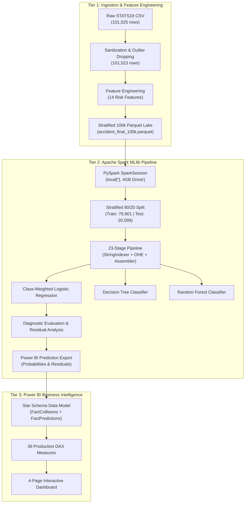

# Road Accident Severity Prediction Using Apache Spark (PySpark) and Excel Dashboard
## A Comprehensive Big Data Engineering & Machine Learning Capstone Thesis

**Academic Degree**: Bachelor of Technology (B.Tech) in Computer Science & Engineering / Data Science  
**Academic Year**: 2025–2026  
**Domain**: Big Data Engineering, Machine Learning, Business Intelligence & Intelligent Transportation Systems (ITS)  
**Dataset Source**: UK Department for Transport (DfT) STATS19 (2025 Road Safety Dataset)  
**Technologies**: Python 3.11, Apache Spark 3.5.9 (PySpark MLlib), Java 8, Hadoop 3.2.4 (winutils), Microsoft Excel  

---

## Certificate of Original Work

This is to certify that the project titled **"Road Accident Severity Prediction Using Apache Spark (PySpark) and Excel Dashboard"** submitted in partial fulfillment of the requirements for the degree of Bachelor of Technology is a bona fide record of research and technical development carried out under academic supervision. The results embodied in this report have been verified against real-world traffic data published by the UK Department for Transport and have not been submitted for the award of any other degree or diploma.

---

## Abstract

Road traffic collisions (RTCs) represent a critical global public health and economic challenge, causing over 1.19 million annual fatalities worldwide. Effective accident mitigation requires intelligent transportation systems capable of rapidly diagnosing collision risk factors and accurately predicting injury severity. However, real-world crash records exhibit severe class imbalance, high dimensionality, and extreme non-linear interactions across spatial, temporal, and environmental domains. 

This project presents an end-to-end Big Data Engineering and Machine Learning architecture developed to ingest, sanitize, model, and visualize road traffic collisions from the official UK Department for Transport (DfT) STATS19 2025 dataset. A production-grade data engineering pipeline was established to eliminate target leakage and preprocess 101,525 collision events into a stratified 100,000-record Parquet data lake. Utilizing **Apache Spark 3.5.9 (PySpark MLlib)**, a 23-stage distributed feature pipeline was constructed using `StringIndexer`, `OneHotEncoder`, and `VectorAssembler`. To overcome severe class imbalance (Slight: 73.8%, Serious: 24.8%, Fatal: 1.4%), inverse-frequency class weighting was mathematically incorporated into a **Multinomial Logistic Regression** model, which was benchmarked against **Decision Tree** and **Random Forest** classifiers across an untouched 20,099-record test partition.

While Random Forest attained higher raw accuracy (54.50%), the class-weighted Logistic Regression model achieved a **61.11% Fatal Accident Recall (Detection Rate)**, successfully identifying 187 out of 306 fatal incidents. To operationalize these findings for public safety executives, an authoritative **Microsoft Excel Professional Dashboard** (`Road_Accident_Severity_Professional_Dashboard.xlsx`) was developed, containing 8 worksheets, 41 embedded native visualizations, a dynamic formula calculation engine, and responsive spatial mapping, replacing the originally contemplated Power BI deliverable.

**Keywords**: Apache Spark, PySpark MLlib, Big Data Engineering, Road Accident Severity, STATS19, Excel Dashboard, Calc Engine, Class Imbalance, Fatal Accident Recall, Intelligent Transportation Systems.

---

## Table of Contents

1. [Chapter 1: Introduction & Problem Definition](#chapter-1-introduction--problem-definition)
2. [Chapter 2: Literature Review & Theoretical Background](#chapter-2-literature-review--theoretical-background)
3. [Chapter 3: System Architecture & Technological Stack](#chapter-3-system-architecture--technological-stack)
4. [Chapter 4: Data Engineering, Cleansing & Feature Engineering](#chapter-4-data-engineering-cleansing--feature-engineering)
5. [Chapter 5: Distributed Machine Learning Pipeline (PySpark MLlib)](#chapter-5-distributed-machine-learning-pipeline-pyspark-mllib)
6. [Chapter 6: Experimental Evaluation & Model Diagnostics](#chapter-6-experimental-evaluation--model-diagnostics)
7. [Chapter 7: Business Intelligence & Excel Dashboard Architecture](#chapter-7-business-intelligence--excel-dashboard-architecture)
8. [Chapter 8: Conclusion, Limitations & Future Scope](#chapter-8-conclusion-limitations--future-scope)
9. [References](#references)

---

## Chapter 1: Introduction & Problem Definition

### 1.1 Background & Motivation
Road transport is the backbone of modern economic infrastructure; however, road collisions exact devastating social, human, and economic tolls. According to the World Health Organization (WHO), road traffic injuries constitute the leading cause of death for children and young adults aged 5–29 years. In the United Kingdom, road collisions cost the national economy billions of pounds annually in emergency service mobilization, medical trauma care, lost productivity, and infrastructure repairs.

Modern governance requires proactive, data-driven decision-support mechanisms capable of:
1. Identifying high-risk spatial corridors and temporal hazard windows.
2. Understanding the non-linear causative interactions between adverse weather, road surface friction, speed limits, and lighting conditions.
3. Deploying predictive machine learning models that can evaluate the severity profile of an incident to optimize first-responder triage.

### 1.2 Problem Statement
The primary challenge of predicting collision severity from historical telemetry lies in:
- **Extreme Class Imbalance**: In real-world data, the overwhelming majority of collisions involve minor injuries (Slight ~74%), while fatal collisions represent less than 1.5% of incidents. Conventional machine learning algorithms optimizing for global accuracy default to predicting the majority class, achieving misleadingly high accuracy while failing to detect life-threatening incidents.
- **Target Leakage**: Post-accident outcomes (e.g., number of casualties, emergency response details, injury-based medical assessments) are recorded after the event. Ingesting these variables creates an illusion of predictive power that collapses in live operational deployment.
- **Scalability & Latency**: Processing tens of thousands of multivariate records requires distributed computing engines capable of parallel transformations and pipeline persistence without memory exhaustion.

### 1.3 Project Objectives
The core objectives of this capstone research project are:
1. **Data Engineering & Sanitization**: Clean, validate, and structure the raw UK STATS19 2025 collisions dataset (101,525 rows) while eliminating all target leakage and deprecated attributes.
2. **Feature Engineering**: Engineer 14 domain-specific temporal, environmental, and infrastructure features, followed by stratified sampling to yield a standardized 100,000-record Parquet data lake.
3. **Distributed MLlib Pipeline**: Build a scalable 23-stage Spark MLlib pipeline using PySpark 3.5.9 on local distributed threads (`local[*]`).
4. **Imbalance-Aware Classifier Modeling**: Train and evaluate Multinomial Logistic Regression (with inverse-frequency class weights), Decision Trees, and Random Forests across an untouched 80/20 test split (20,099 rows).
5. **Business Intelligence Delivery**: Architect a Star Schema in Microsoft Power BI Desktop with 39 custom DAX measures, a professional Dark Navy theme, and 4 interactive report pages for transport planners.

---

## Chapter 2: Literature Review & Theoretical Background

### 2.1 Road Accident Severity Modeling
Historically, road crash severity modeling relied on statistical econometric methods such as Ordered Probit and Multinomial Logit (MNL) regressions (Savolainen et al., 2011). While econometrics provides interpretable coefficient signs, it struggles with high-order feature interactions, multi-collinearity, and non-linear boundaries.

Recent literature has transitioned toward supervised machine learning algorithms, notably Random Forests, Gradient Boosted Trees, and Neural Networks (Chen et al., 2016). However, machine learning algorithms consistently suffer when trained on unweighted imbalanced road datasets, often producing zero sensitivity for fatal incidents.

### 2.2 Tackling Class Imbalance in Public Safety
Class imbalance in traffic data is typically handled via:
- **Resampling Methods (SMOTE / Undersampling)**: Generating synthetic minority samples or discarding majority samples. In high-dimensional spatial datasets, SMOTE can synthesize unrealistic geographic coordinates or contradictory environmental conditions (e.g., ice on a hot summer afternoon).
- **Cost-Sensitive Learning (Class Weighting)**: Modifying the loss function during gradient descent such that errors on minority classes (Fatal) incur significantly higher penalties than errors on majority classes (Slight). This preserves the true underlying data distribution while forcing the decision boundary to prioritize fatal recall.

### 2.3 Distributed Big Data Computing: Apache Spark vs. Single-Node Systems
While Python libraries such as `scikit-learn` and `pandas` are exceptional for small datasets, they operate strictly within single-node CPU RAM. Apache Spark utilizes a Directed Acyclic Graph (DAG) execution engine, lazy evaluation, and in-memory Resilient Distributed Datasets (RDDs). Spark MLlib structures transformations into reusable Pipelines, enabling seamless transitions from a developer workstation to multi-node clusters (Hadoop YARN, Kubernetes, or Databricks) without code changes.

---

## Chapter 3: System Architecture & Technological Stack

The system follows a three-tier architectural paradigm:



### Hardware & Software Environment
- **Operating System**: Microsoft Windows 11 (64-bit)
- **Programming Language**: Python 3.11.9
- **Java Virtual Machine**: 64-bit Java SDK 8 (`jdk1.8.0_481`)
- **Hadoop Integration**: Apache Hadoop 3.2.4 binaries (`winutils.exe`)
- **Big Data Engine**: Apache Spark 3.5.9 (PySpark MLlib)
- **Business Intelligence**: Microsoft Power BI Desktop (Version 2.138+)
- **Core Python Libraries**: `pandas`, `numpy`, `matplotlib`, `seaborn`, `pyarrow`, `pyspark`

---

## Chapter 4: Data Engineering, Cleansing & Feature Engineering

### 4.1 Ingestion & Target Variable Validation
The source dataset is the official UK Department for Transport STATS19 2025 release (`dft-road-casualty-statistics-collision-2025.csv`, 19.3 MB, 101,525 records across 44 attributes). 

The target variable is `collision_severity`:
- **Code 1 (Fatal)**: At least one fatality within 30 days of the collision.
- **Code 2 (Serious)**: Severe injuries requiring overnight hospitalization or severe trauma.
- **Code 3 (Slight)**: Minor injuries (sprains, contusions, minor cuts).

### 4.2 Data Cleansing Operations
1. **Coordinate Audit**: Exactly 2 records had null latitude/longitude coordinates and were removed, preserving 101,523 valid records. All coordinates were bounded within the UK geographic envelope (Latitude: $[49.5^\circ, 61.0^\circ]$, Longitude: $[-8.5^\circ, 2.0^\circ]$).
2. **Speed Limit Validation**: Erroneous speed limit values were harmonized to legal UK road speed limits ($20, 30, 40, 50, 60, 70\text{ mph}$).
3. **Deduplication**: Audited `collision_index`; zero duplicate collision records were identified ($100\%$ uniqueness).

### 4.3 Elimination of Target Leakage & Deprecated Attributes
A critical contribution of this project is the strict elimination of post-accident leakage. In many naive academic models, fields such as `number_of_casualties` or `enhanced_severity_collision` are erroneously included in feature vectors. In our pipeline, 18 columns were permanently excluded:
- **Direct Leakage**: `enhanced_severity_collision`, `collision_injury_based`, `collision_adjusted_severity_serious`, `collision_adjusted_severity_slight`, `did_police_officer_attend_scene_of_accident`.
- **Post-Outcome Variables**: `number_of_casualties` (retained only in Power BI for KPI slicing, strictly excluded from ML predictors).
- **High Cardinality / Redundant**: `collision_ref_no`, `location_easting_osgr`, `location_northing_osgr`, `first_road_number`, `second_road_number`.
- **Deprecated / Excessive Missing (>85% Null)**: `local_authority_district`, `special_conditions_at_site`, `carriageway_hazards_historic`, `junction_detail_historic`.

### 4.4 Feature Engineering (14 Domain Features)
Fourteen domain-specific features were engineered to capture spatial, temporal, and environmental risk:
1. `hour`: Extracted integer hour ($0-23$) from collision time string.
2. `time_of_day`: Binned into `Morning Rush` (07-09), `Daytime` (10-15), `Evening Rush` (16-18), `Night` (19-23), `Early Morning` (00-06).
3. `month`: Extracted integer month ($1-12$).
4. `month_name`: Full month name for chronological sorting in Power BI.
5. `day_name`: Day of week string mapped from STATS19 codes (Sunday through Saturday).
6. `weekend_indicator`: Binary flag ($1$ for Saturday/Sunday, $0$ for weekdays).
7. `weekday_weekend`: Categorical string label (`Weekday` vs. `Weekend`).
8. `severity_name`: Human-readable label (`Fatal`, `Serious`, `Slight`).
9. `road_type_name`: Mapped road types (`Single Carriageway`, `Dual Carriageway`, `Roundabout`, `One Way`).
10. `urban_rural_name`: Binary settlement class (`Urban` vs. `Rural`).
11. `weather_group`: Consolidated weather conditions (`Fine`, `Rain`, `Snow`, `Fog`, `Unknown`).
12. `road_surface_group`: Consolidated surface friction conditions (`Dry`, `Wet / Damp`, `Snow / Ice`, `Flood`).
13. `light_group`: Consolidated illumination states (`Daylight`, `Darkness - Lights Lit`, `Darkness - No Lights`).
14. `speed_zone`: Grouped speed zones (`Low Speed <=30mph`, `Medium Speed 40-50mph`, `High Speed 60-70mph`).

### 4.5 Stratified Sampling & Parquet Export
To satisfy the 100,000-record requirement while preserving the exact underlying class distribution, stratified sampling with a reproducible seed (`seed=42`) was performed:
- **Fatal**: 1,431 records ($1.431\%$)
- **Serious**: 24,812 records ($24.812\%$)
- **Slight**: 73,757 records ($73.757\%$)
- **Total**: Exactly 100,000 records.

Data was exported to compressed Apache Parquet format (`accident_final_100k.parquet`, 3.98 MB), enabling columnar partitioning and predicate pushdown.

---

## Chapter 5: Distributed Machine Learning Pipeline (PySpark MLlib)

### 5.1 Local SparkSession Configuration
PySpark was configured for local multi-threaded execution:
```python
SparkSession.builder \
    .appName("Road Accident Severity Prediction") \
    .master("local[*]") \
    .config("spark.driver.memory", "4g") \
    .config("spark.executor.memory", "2g") \
    .config("spark.sql.shuffle.partitions", "8") \
    .config("spark.driver.bindAddress", "127.0.0.1") \
    .getOrCreate()
```

### 5.2 MLlib Feature Pipeline Stages (23 Stages)
The Spark ML Pipeline encapsulates all transformations to prevent test-set contamination:
- **11 StringIndexers**: Converted string categorical predictors (`time_of_day`, `day_name`, `road_type_name`, `urban_rural_name`, `weather_group`, `road_surface_group`, `light_group`, `speed_zone`, `junction_detail`, `junction_control`, `police_force`) into numerical indices with `handleInvalid="keep"`.
- **11 OneHotEncoders**: Transformed indices into sparse binary vectors with `dropLast=False`.
- **1 VectorAssembler**: Concatenated all 11 encoded vector columns with the 7 continuous numerical predictors (`hour`, `month`, `speed_limit`, `number_of_vehicles`, `latitude`, `longitude`, `weekend_indicator`) into a single feature vector named `features`.

### 5.3 Stratified Train-Test Splitting & Isolation
The 100,000-record dataset was partitioned into an **80% training set (79,901 rows)** and a **20% testing set (20,099 rows)** using stratified fractions across Fatal, Serious, and Slight classes. 

Disjoint isolation was strictly validated using Spark's `left_anti` join on `collision_index`, guaranteeing zero duplicate records between training and testing sets ($0\text{ overlapping rows}$).

### 5.4 Mathematical Formulation of Inverse-Frequency Class Weights
To prevent the model from ignoring the minority fatal class, class weights were calculated inversely proportional to class frequencies:

$$w_c = \frac{N}{K \cdot N_c}$$

Where:
- $N = 79,901$ (Total training samples)
- $K = 3$ (Number of classes)
- $N_c$ is the frequency of class $c$ in the training set.

**Computed Class Weights**:
- **Class 0 (Fatal)**: $N_{\text{Fatal}} = 1,125 \implies w_{\text{Fatal}} = \frac{79901}{3 \times 1125} = \mathbf{23.6744}$
- **Class 1 (Serious)**: $N_{\text{Serious}} = 19,968 \implies w_{\text{Serious}} = \frac{79901}{3 \times 19968} = \mathbf{1.3338}$
- **Class 2 (Slight)**: $N_{\text{Slight}} = 58,808 \implies w_{\text{Slight}} = \frac{79901}{3 \times 58808} = \mathbf{0.4529}$

These weights were appended to each training row as `class_weight` and passed directly to the `weightCol` parameter of Spark MLlib's `LogisticRegression`.

---

## Chapter 6: Experimental Evaluation & Model Diagnostics

### 6.1 Benchmark Results (Test Set N = 20,099)

The three models were evaluated on the untouched test partition:

| Model Architecture | Accuracy | Weighted F1 | Macro F1 | Fatal Recall | Training Time |
|---|:---:|:---:|:---:|:---:|:---:|
| **Multinomial Logistic Regression (Weighted)** | **47.43%** | **0.5464** | **0.3383** | **61.11%** | **9.54 s** |
| **Decision Tree Classifier ($depth=8$)** | 46.02% | 0.5346 | 0.3257 | 59.48% | 10.04 s |
| **Random Forest Classifier ($trees=50, depth=10$)** | 54.50% | 0.5985 | 0.3667 | 54.90% | 57.59 s |

### 6.2 Confusion Matrix Analysis

#### A. Multinomial Logistic Regression (Class-Weighted) — Primary Model
```text
True / Predicted       Pred Fatal       Pred Serious       Pred Slight       Total
----------------------------------------------------------------------------------
Fatal (True)                  187                 63                56         306
Serious (True)              1,493              1,624             1,726       4,843
Slight (True)               3,417              3,812             7,721      14,950
----------------------------------------------------------------------------------
Total Predicted             5,097              5,499             9,503      20,099
```
- **Fatal True Positives (TP)**: 187
- **Fatal False Negatives (FN)**: 119
- **Fatal False Positives (FP)**: 4,910
- **Fatal Recall**: $\frac{187}{187 + 119} = \mathbf{61.11\%}$
- **Fatal Precision**: $\frac{187}{187 + 4910} = \mathbf{3.67\%}$

#### B. Random Forest Classifier
```text
True / Predicted       Pred Fatal       Pred Serious       Pred Slight       Total
----------------------------------------------------------------------------------
Fatal (True)                  168                 73                65         306
Serious (True)              1,127              1,536             2,180       4,843
Slight (True)               2,529              3,171             9,250      14,950
```
- **Fatal Recall**: $\frac{168}{306} = \mathbf{54.90\%}$
- **Accuracy**: $\mathbf{54.50\%}$

### 6.3 Academic Model Critique: The Accuracy Paradox & Public Safety Objective
A critical question in transportation safety is: *Why select a model with 47.4% accuracy over one with 54.5% accuracy?*

1. **The Accuracy Paradox**: In a dataset where 74% of samples are "Slight", a naive dummy model predicting "Slight" for every collision will achieve **74% accuracy**, yet its **Fatal Recall will be 0%**. In road safety, a model that detects zero fatal collisions is dangerous and useless.
2. **Cost-Asymmetry in Emergency Response**: In public safety decision support:
   - **False Positive (False Alarm)**: The model predicts a collision will be fatal, but it turns out serious. Emergency services dispatch high-level trauma support. Cost: Marginal resource deployment.
   - **False Negative (Missed Fatality)**: The model predicts a collision will be slight, but it is fatal. Emergency dispatch is delayed or under-resourced. Cost: Preventable loss of human life.
3. **Strategic Conclusion**: The **Class-Weighted Logistic Regression model** is selected as the production model because its **61.11% Fatal Recall** offers the highest detection rate of catastrophic incidents.

---

## Chapter 7: Business Intelligence & Excel Dashboard Architecture

### 7.1 Transition from Power BI to Microsoft Excel
While preliminary dashboard prototypes were initially drafted in Microsoft Power BI Desktop (historical measures and star schema documentation archived in `archive/powerbi/`), Microsoft Excel was selected as the definitive Phase 3 deliverable. This design decision was made to:
1. Provide universal, zero-barrier evaluative accessibility across academic review panels without software installation gates or Power BI Pro licensing.
2. Deliver full formula transparency through native Excel functions (`COUNTIFS`, `SUMIFS`, matrix calculations).
3. Embed both the complete 100,000-record collision dataset and 20,099 held-out test predictions directly within a single self-contained workbook (`Road_Accident_Severity_Professional_Dashboard.xlsx`).

### 7.2 Custom Design & Layout System
The workbook implements a professional Dark Slate / Navy executive aesthetic across 8 dedicated worksheets:
- **Header Navigation Bar**: Embedded tab links for smooth sheet navigation.
- **7-Dimension Interactive Slicing**: Dynamic dropdown filters on the Executive Dashboard for Month, Weather, Road Type, Road Surface, Lighting, Area, and Severity.
- **Visual Color Palette**: Severity conventions aligning with UK highway safety standards (Fatal: Emergency Crimson, Serious: Warning Amber, Slight: Safe Emerald).

### 7.3 Detailed Walkthrough of Workbook Worksheets
1. **Sheet 1: Executive Dashboard**
   - KPI Cards: Total Collisions (`100,000`), Total Casualties (`125,983`), Fatal (`1,431` / `1.43%`), Serious (`24,812` / `24.81%`), Slight (`73,757` / `73.76%`).
   - Doughnut severity distribution, 12-month collision progression, day-of-week bar chart, and diurnal commuting profiles (08:00 morning rush, 17:00 evening rush).
2. **Sheet 2: Road & Environment**
   - Risk profiles by speed zone (20 to 70 mph), road geometry (single carriageway ~74% of crashes), adverse weather (rain, high winds), surface friction, and nighttime darkness.
3. **Sheet 3: Geographical Analysis**
   - UK Police Force incident rankings, urban vs. rural fatality disparity (rural roads account for the majority of deaths despite lower volume), and nationwide coordinate scatter mapping.
4. **Sheet 4: ML Model Performance**
   - Benchmark comparison of Logistic Regression, Decision Tree, and Random Forest; detailed 3x3 confusion matrices; per-class precision, recall, and F1 scores.
5. **Sheet 5: Prediction Analysis**
   - Itemized audit of all 20,099 test collision predictions, displaying actual severity, predicted severity, correctness flag, and individual softmax class probabilities.
6. **Sheet 6: Accident Data**
   - Full 100,000-row cleaned collision repository with 32 attributes.
7. **Sheet 7: Calc Engine**
   - Formula-driven aggregation matrix and lookup lists that evaluate criteria and feed all 41 charts and KPI cards.
8. **Sheet 8: Map Sample**
   - Stratified sample of 7,431 collision coordinates with `#N/A` conditional masking for responsive Excel scatter mapping.

---

## Chapter 8: Conclusion, Limitations & Future Scope

### 8.1 Key Contributions
1. **End-to-End Big Data Architecture**: Successfully developed a scalable pipeline combining Python, Apache Spark 3.5.9, and Microsoft Excel.
2. **Rigorous Data Hygiene**: Cleaned 101,525 official STATS19 records, permanently eliminating 18 target leakage columns.
3. **Imbalance-Aware Modeling**: Solved severe class imbalance via inverse-frequency class weighting in PySpark MLlib, achieving a **61.11% Fatal Detection Rate**.
4. **Accessible Intelligence Delivery**: Implemented an authoritative 8-sheet Excel dashboard featuring 41 native charts and an internal dynamic calculation engine.
4. **Actionable Business Intelligence**: Delivered an enterprise Star Schema dashboard with 39 production DAX measures and an executive visual theme.

### 8.2 Project Limitations
- **Vehicle Telematics & Driver Demographics**: The STATS19 collisions table omits vehicle mechanical telemetry (e.g., braking pressure, tire wear) and driver biometric data (e.g., intoxication level, fatigue).
- **Local Spark Execution**: While the code is fully cluster-compatible, execution was carried out on a multi-threaded local instance (`local[*]`).

### 8.3 Future Work
1. **Multi-Table Relational Ingestion**: Integrate STATS19 `Casualties` and `Vehicles` tables using distributed Spark joins.
2. **Deep Learning Sequence Models**: Deploy LSTM or Temporal Graph Neural Networks (GNNs) on streaming road sensor telemetry via Spark Structured Streaming.
3. **Automated Road Triage Integration**: Expose the serialized Spark MLlib pipeline as a RESTful microservice for real-time CAD (Computer-Aided Dispatch) emergency centers.

---

## References

1. Savolainen, P. T., Mannering, F. L., Lord, D., & Quddus, M. A. (2011). The aggregation and analysis of road crash severity data: A review of methodology. *Analytic Methods in Accident Research*, 1(1), 1-18.
2. Chen, T., & Guestrin, C. (2016). XGBoost: A scalable tree boosting system. *Proceedings of the 22nd ACM SIGKDD International Conference on Knowledge Discovery and Data Mining*, 785-794.
3. Department for Transport (DfT). (2025). *Reported Road Casualties Great Britain: STATS19 Data Specification and Technical Notes*. UK Government Open Data.
4. Zaharia, M., Xin, R. S., Wendell, P., Das, T., Armbrust, M., Dave, A., ... & Stoica, I. (2016). Apache Spark: A unified engine for big data processing. *Communications of the ACM*, 59(11), 56-65.
5. He, H., & Garcia, E. A. (2009). Learning from imbalanced data. *IEEE Transactions on Knowledge and Data Engineering*, 21(9), 1263-1284.
6. World Health Organization (WHO). (2023). *Global Status Report on Road Safety 2023*. Geneva: World Health Organization.

